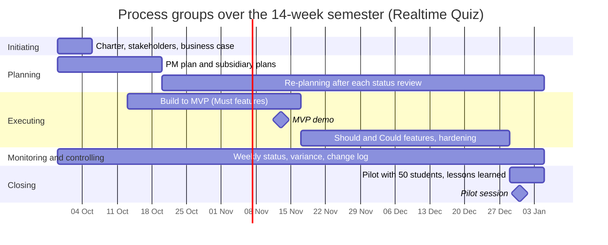

# Process groups over the 14-week semester

Week 1 starts on 2026-09-29; week n starts 7 x (n - 1) days later, so week 7 starts on 2026-11-10 and week 14 on 2026-12-29. The five process groups overlap and repeat; they are not phases one after another.

| Process group | Weeks active | Main activities | Outputs | Lab that produces them |
|---------------|--------------|-----------------|---------|------------------------|
| Initiating | 1 | classify the initiative, write the charter, identify sponsor, project manager and first stakeholders, justify the investment with a business case | project charter, stakeholder list, business case | Lab-01 |
| Planning | 1-3 first burst, then 4-14 continuing re-planning | write the PM plan and subsidiary plans (scope, schedule, budget, risk, stakeholders), baseline it in week 3, then update it after each status review and approved change | PM plan baseline, subsidiary plans, updated plan versions | Lab-01 starts it; later labs (schedule in Lab-05) refine it |
| Executing | 3-13 | build to the MVP (Must features, week 7), then Should and Could features, hardening, the load test and the hand-over pack; lead and support the team | tagged working increments and demos per build phase, MVP, load test report, runbook | the build work itself (practice), not a lab deliverable |
| Monitoring and controlling | 1-14 | weekly status meeting, schedule and cost variance, risk review, change requests, phase gates | status reports, change log, updated baselines, gate decisions | Labs 05, 06, 09 (tools), every lab (practice) |
| Closing | 14 | pilot with 50 students, acceptance by the sponsor, hand-over to IT operations, lessons learned, release of the team | pilot report, signed acceptance, hand-over pack, lessons learned | Lab-01 plans it; practice in week 14 |

## Process groups over the semester

## Phase gates
At three points the sponsor decides to continue, change or stop the project. Each gate needs evidence, so the decision rests on a continued business justification (the PRINCE2 idea) and not on feeling.
- **Week 1, charter approval:** the sponsor has the signed charter (`project-charter.md`), the stakeholder list and the business case, whose recommendation is to build option C. Evidence: both signatures on the charter and the budget of 490 h and 200 USD agreed.
- **Week 7, MVP demo:** all 8 Must features pass a live demo run (objective O1), line coverage is at least 80 % and CI is green. Evidence: the demo record, the CI and coverage report, and a status report with effort and cost variance. If the demo fails, the business case says to switch to option B (buy a SaaS) for next semester.
- **Week 13, pilot readiness:** the load test with 100 simulated students and 20 concurrent sessions is green (O3, O4), the data approval from the data protection officer or registrar has arrived, and the runbook has been handed to IT operations. Evidence: the load test report, the written approval and the handover sign-off. If one is missing, the sponsor decides whether to move the pilot, which needs written approval under the charter's authority clause.
